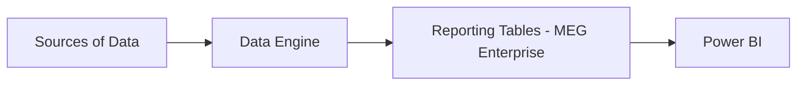

# OC Compliance Architecture Diagrams

Configuration-driven Mermaid diagrams for the OC Compliance Platform. **Stage 1** shows the end-to-end flow; **Stage 2** expands each stage into its components. Both diagrams are generated from one YAML configuration and render in GitLab's Markdown viewer.

## Stage 1 — High-Level Architecture

<!-- BEGIN GENERATED STAGE_1 -->

<!-- END GENERATED STAGE_1 -->

[Open Stage 1 as a separate document](docs/01_high_level_architecture.md)

## Stage 2 — Component Architecture

```mermaid
flowchart LR
    subgraph sources["Sources of Data"]
        direction TB
        sources_1["Azure CLI"]
        sources_2["kubectl"]
        sources_3["AppDir"]
        sources_4["CMDB"]
        sources_5["Azure Blob Storage"]
        sources_6["Other Sources"]
    end
    subgraph engine["Data Engine"]
        direction TB
        engine_1["application_details"]
        engine_2["cluster_details"]
        engine_3["namespace_details"]
        engine_4["compliances"]
        engine_5["compliance_rules"]
        engine_6["compliance_results"]
    end
    subgraph reporting["Reporting Tables - MEG Enterprise"]
        direction TB
        reporting_1["oc_compliance_summary"]
        reporting_2["namespace_oc_compliance_view"]
    end
    subgraph powerbi["Power BI"]
        direction TB
        powerbi_1["OC Compliance Percentage"]
        powerbi_2["Namespace Compliance View"]
    end
    sources --> engine
    engine --> reporting
    reporting --> powerbi
```

<!-- BEGIN GENERATED STAGE_2 -->

<!-- END GENERATED STAGE_2 -->

[Open Stage 2 as a separate document](docs/02_component_architecture.md)

## Project structure

```text
oc-architecture-diagrams/
├── config/
│   └── architecture.yaml               # Single source of truth
├── scripts/
│   └── generate_architecture.py        # Generates both docs and README diagrams
├── docs/
│   ├── 01_high_level_architecture.md
│   └── 02_component_architecture.md
├── .gitlab-ci.yml                      # Validates generated files
├── .gitignore
├── requirements.txt
└── README.md                            # GitLab landing page with embedded diagrams
```

## Prerequisites

- Python 3.9 or newer
- VS Code (recommended) and a terminal
- Git for committing changes
- GitLab instance supporting Mermaid rendering (already confirmed)

## Run locally in VS Code

1. Extract the ZIP or clone the GitLab repository.
2. Open the `oc-architecture-diagrams` folder in VS Code.
3. Open **Terminal → New Terminal**.
4. Create a virtual environment and install dependencies:

**macOS / Linux:**

```bash
python3 -m venv .venv
source .venv/bin/activate
python -m pip install -r requirements.txt
```

**Windows PowerShell:**

```powershell
py -m venv .venv
.venv\Scripts\Activate.ps1
python -m pip install -r requirements.txt
```

5. Generate Stage 1, Stage 2 and the embedded README diagrams:

```bash
python scripts/generate_architecture.py
```

6. Preview `README.md` in VS Code using **Markdown: Open Preview** (Mermaid preview support may require an extension), or push to GitLab to see both rendered diagrams.

## How to update diagrams

1. Open `config/architecture.yaml`.
2. Update `name` for a stage heading, or add/remove entries under its `components` list.
3. Run `python scripts/generate_architecture.py`.
4. Review changes to `README.md` and both files in `docs/`.
5. Commit the YAML and generated Markdown files together and open a merge request.

**Example:** To add ServiceNow, add `- ServiceNow` under the `sources` stage's `components` list. Stage 2 and the embedded Stage 2 diagram in the README will update on regeneration. Stage 1 remains the same unless a stage heading or stage ordering changes.

**Do not manually edit generated Mermaid blocks** in `README.md` or `docs/`: the generator will overwrite those edits. Make changes in `config/architecture.yaml` instead. Component/table names in the initial YAML are illustrative and should be reviewed before approval.

## Contribution workflow

1. Create a feature branch from the default branch.
2. Modify only the source configuration for diagram content.
3. Regenerate and inspect the diagrams locally.
4. Commit `config/architecture.yaml`, `README.md`, and `docs/*.md` together.
5. Push your branch and create a merge request for technical review.
6. Ensure the GitLab validation job passes before merging.

## GitLab CI/CD behavior

The pipeline runs the generator and checks that the committed `README.md` and both generated docs match the YAML configuration. It fails if someone changes YAML without regenerating diagrams. Generated files are also published as pipeline artifacts. **The pipeline does not commit files back to GitLab.**

## Scope

Stage 1 and Stage 2 only. Stage 3 (database ERD) is reserved for a later iteration.
